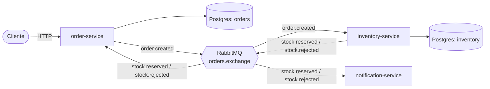
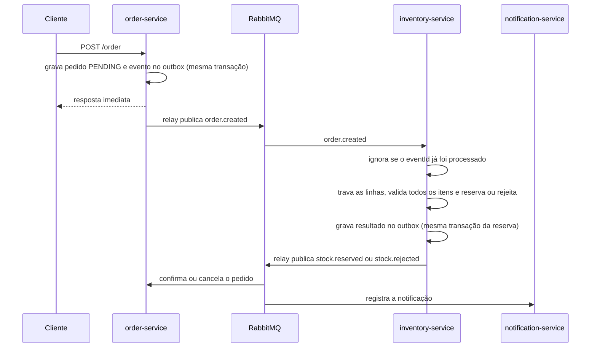

# E-commerce Microservices

Sistema de pedidos em microserviços com **Java 21 e Spring Boot 3**, comunicação assíncrona via **RabbitMQ** e consistência garantida pelo padrão **Transactional Outbox**.

O projeto simula o fluxo de um e-commerce: o cliente cria um pedido, o estoque é reservado (ou o pedido é rejeitado) e o cliente é notificado, sem que nenhum serviço chame outro diretamente.

## Sumário

- [Arquitetura](#arquitetura)
- [Fluxo de um pedido](#fluxo-de-um-pedido)
- [Decisões de projeto](#decisões-de-projeto)
- [Stack](#stack)
- [Como rodar](#como-rodar)
- [Testando o fluxo](#testando-o-fluxo)
- [Testes automatizados](#testes-automatizados)
- [Limitações conhecidas](#limitações-conhecidas)
- [Roadmap](#roadmap)
- [Estrutura do repositório](#estrutura-do-repositório)

## Arquitetura

| Serviço | Porta | Banco | Responsabilidade |
|---|---|---|---|
| `order-service` | 8081 | `orders` | Cria e consulta pedidos, confirma ou cancela conforme o resultado do estoque |
| `inventory-service` | 8082 | `inventory` | Cadastra estoque, reserva itens e responde com sucesso ou rejeição |
| `notification-service` | 8083 | nenhum | Notifica o cliente sobre o resultado (hoje, registra no log) |



Cada serviço tem o seu próprio banco e nunca acessa o banco do outro. Toda a comunicação entre eles acontece por eventos.

### Eventos

Exchange: `orders.exchange` (tipo topic).

| Evento | Routing key | Produtor | Consumidores |
|---|---|---|---|
| `OrderCreated` | `order.created` | order-service | inventory-service |
| `StockReserved` | `stock.reserved` | inventory-service | order-service, notification-service |
| `StockRejected` | `stock.rejected` | inventory-service | order-service, notification-service |

A routing key descreve o **evento**, e não quem o consome. Cada consumidor declara a sua própria fila ligada à mesma chave, então adicionar um novo consumidor não exige mudar o produtor.

## Fluxo de um pedido



1. O cliente cria o pedido. Ele é salvo como `PENDING` e a resposta volta na hora, sem esperar o estoque.
2. O estoque recebe `OrderCreated`, soma as quantidades por produto, trava as linhas e valida **todos** os itens antes de alterar qualquer um.
3. Se tudo cabe, reserva e publica `StockReserved`. Se qualquer item falha, não altera nada e publica `StockRejected` com o motivo.
4. O `order-service` muda o pedido para `CONFIRMED` ou `CANCELLED`, e o `notification-service` registra a notificação.

Por isso a resposta do `POST` é sempre a mesma, e o resultado real aparece depois, no status do pedido. Isso é consistência eventual: por alguns instantes o pedido fica `PENDING`.

## Decisões de projeto

| Decisão | Motivo |
|---|---|
| **Banco por serviço** | Os serviços ficam independentes e só se conhecem pelos eventos |
| **Saga coreografada** | Não há serviço orquestrador, cada um reage aos eventos dos outros |
| **Transactional Outbox** (pedido e estoque) | O evento é gravado na mesma transação do dado de negócio e publicado depois por um relay. Elimina a corrida entre publicar e fazer commit, e o evento não se perde se a aplicação cair |
| **Consumidores idempotentes** | O RabbitMQ entrega "pelo menos uma vez". O estoque guarda o `eventId` em `processed_events`, e o pedido ignora quem já saiu de `PENDING` |
| **Lock pessimista no estoque** | `SELECT ... FOR UPDATE` ordenado por `product_id` evita reservar o último item duas vezes e evita deadlock entre pedidos que dividem produtos |
| **Reserva "tudo ou nada"** | Valida todos os itens antes de reservar qualquer um, então não há nada a desfazer |
| **Rejeição não é exceção** | Falta de estoque é um resultado de negócio. Lançar exceção desfaria a transação e faria o RabbitMQ reentregar a mensagem para sempre |
| **Regras de negócio nas entidades** | `Order` e `Stock` não têm setters. O estado só muda por métodos como `confirm()`, `cancel()`, `reserve()` e `release()`, que protegem as regras |
| **DTOs separados das entidades** | A API nunca expõe a entidade, e o request só carrega o que o cliente pode decidir |
| **Erros no formato `ProblemDetail` (RFC 7807)** | Um formato padrão da plataforma, em vez de um inventado |
| **Eventos duplicados em cada serviço** | Sem biblioteca compartilhada, para os serviços não dependerem das mesmas versões. O contrato é o JSON |
| **Entidade recebe o DTO no construtor** | Menos código no service. O custo é a entidade conhecer o pacote de requests |

## Stack

- Java 21, Spring Boot 3.3.5, Maven multi-módulo
- Spring Web, Spring Data JPA, Bean Validation
- PostgreSQL com Flyway (migrations versionadas)
- RabbitMQ com Spring AMQP (mensagens em JSON)
- springdoc-openapi (Swagger UI)
- Spring Boot Actuator e Micrometer Prometheus
- JUnit 5, AssertJ e Mockito
- Lombok
- Docker Compose (infraestrutura) e GitHub Actions (CI)

## Como rodar

### Pré-requisitos

- JDK 21 e Maven
- Docker (para o RabbitMQ)
- PostgreSQL local

### 1. Bancos de dados

Crie dois bancos vazios. O Flyway cria as tabelas na primeira execução.

```sql
CREATE DATABASE orders;
CREATE DATABASE inventory;
```

Rode um comando por vez, pois o `CREATE DATABASE` não funciona dentro de uma transação.

### 2. Credenciais

Crie um arquivo `.env` na raiz do projeto (ele não vai para o Git):

```
DB_USER=postgres
DB_PASSWORD=sua_senha
```

Os serviços leem esse arquivo automaticamente. Se a porta do seu Postgres não for `5432`, defina `DB_URL` no `application.yml` de cada serviço.

### 3. RabbitMQ

```bash
docker compose up -d rabbitmq
```

O painel fica em http://localhost:15672 (usuário `guest`, senha `guest`).

### 4. Subir os serviços

Suba nesta ordem, pela IDE ou pelo terminal. O estoque vai primeiro para a sua fila já existir.

```bash
mvn -pl inventory-service spring-boot:run
mvn -pl order-service spring-boot:run
mvn -pl notification-service spring-boot:run
```

### 5. Documentação da API

- Pedidos: http://localhost:8081/swagger-ui.html
- Estoque: http://localhost:8082/swagger-ui.html

## Testando o fluxo

### Cadastrar produtos

`POST /stock` no `inventory-service`:

```json
{
  "productId": "7c9e6679-7425-40de-944b-e07fc1f90ae7",
  "available": 10
}
```

```json
{
  "productId": "b2c3d4e5-1111-4222-8333-944455556666",
  "available": 3
}
```

### Pedido que cabe no estoque

`POST /order` no `order-service`. O pedido deve virar `CONFIRMED`.

```json
{
  "customerId": "3fa85f64-5717-4562-b3fc-2c963f66afa6",
  "items": [
    { "productId": "7c9e6679-7425-40de-944b-e07fc1f90ae7", "quantity": 2, "unitPrice": 49.90 },
    { "productId": "b2c3d4e5-1111-4222-8333-944455556666", "quantity": 1, "unitPrice": 15.50 }
  ]
}
```

O total é `115.30`, e o estoque passa a ter `available` 8 e 2, com `reserved` 2 e 1.

### Pedido que não cabe

O segundo produto tem 3 unidades e o pedido pede 5. O pedido deve virar `CANCELLED`, e **nenhum** estoque pode mudar, nem o do primeiro item, que sozinho caberia.

```json
{
  "customerId": "3fa85f64-5717-4562-b3fc-2c963f66afa6",
  "items": [
    { "productId": "7c9e6679-7425-40de-944b-e07fc1f90ae7", "quantity": 1, "unitPrice": 49.90 },
    { "productId": "b2c3d4e5-1111-4222-8333-944455556666", "quantity": 5, "unitPrice": 15.50 }
  ]
}
```

### Consultar o resultado

Use o `id` devolvido pelo `POST` em `GET /order/{id}`. Espere cerca de um segundo, porque a decisão é assíncrona.

### Demonstração do Outbox: o broker cai no meio

Este é o teste que mostra o que o padrão resolve.

1. Pare o broker: `docker compose stop rabbitmq`.
2. Crie um pedido que caiba no estoque. O `POST` ainda responde normalmente.
3. No banco `orders`, a linha de `outbox_events` fica com `published_at` vazio, e o pedido fica `PENDING`.
4. Suba o broker de novo: `docker compose start rabbitmq`.
5. Em poucos segundos o relay publica o evento, o estoque reserva e o pedido vira `CONFIRMED`, sem ninguém reenviar nada.

### Validação e erros

Lista de itens vazia, quantidade zero ou campos ausentes devolvem `400` com os campos inválidos. Um pedido inexistente devolve `404`, e cadastrar o mesmo produto duas vezes no estoque devolve `409`.

## Testes automatizados

```bash
mvn test
```

| Classe | O que cobre |
|---|---|
| `StockTest` | Criação do estoque, reserva (caso limite, falha sem alterar o estado, acúmulo) e liberação |
| `OrderTest` | Criação, cálculo do total, vínculo dos itens, transições de status e proteção da lista de itens |

As regras de negócio vivem nas entidades, então os testes mais importantes rodam sem Spring e sem banco, em milissegundos.

## Limitações conhecidas

Dizer o que o projeto não faz faz parte do projeto.

- **Entrega "pelo menos uma vez".** Se a aplicação cair entre enviar e marcar como publicado, a mensagem sai duas vezes. Os consumidores são idempotentes, então isso não gera efeito colateral.
- **O relay assume uma instância por serviço.** Com várias instâncias seria preciso `FOR UPDATE SKIP LOCKED` na consulta do lote.
- **Sem confirmação do broker.** O relay marca como publicado depois de enviar, sem esperar o publisher confirm do RabbitMQ.
- **Sem dead letter queue.** Um evento para um pedido inexistente é registrado no log e descartado. Uma falha técnica repetida volta para a fila.
- **A tabela de outbox nunca é limpa.** Linhas publicadas ficam acumulando.
- **A notificação só escreve no log.** Os eventos carregam apenas o `orderId`, e não há dados do cliente. O consumidor também não guarda o `eventId`, então uma entrega repetida gera uma linha de log repetida.
- **O preço vem do cliente.** Não existe catálogo de produtos nem de clientes.
- **Sem autenticação.**

## Roadmap

- [ ] Testes de serviço com Mockito (`StockService` e `OrderService`)
- [ ] Teste de integração com Testcontainers (Postgres e RabbitMQ), incluindo concorrência no lock do estoque
- [ ] Retry com backoff e dead letter queue
- [ ] Publisher confirms e `SKIP LOCKED` no relay, mais limpeza do outbox
- [ ] `docker compose up --build` subindo os três serviços e os bancos
- [ ] Métricas no Prometheus e painel no Grafana
- [ ] Correlation ID nos logs entre serviços

## Estrutura do repositório

```
ecommerce-microservices/
├── pom.xml                  # parent multi-módulo
├── docker-compose.yml
├── .github/workflows/ci.yml
├── docs/
├── order-service/
│   └── src/main/java/com/portfolio/order/
│       ├── controller/  service/  repository/  entity/  enums/
│       ├── dtos/request  dtos/response
│       ├── exception/
│       └── messaging/   (config, event, listener, outbox, publisher)
├── inventory-service/
│   └── src/main/java/com/portfolio/inventory/
│       └── (mesma organização, com StockService e o lock no repository)
└── notification-service/
    └── src/main/java/com/portfolio/notification/
        └── (service e messaging, sem banco nem API)
```